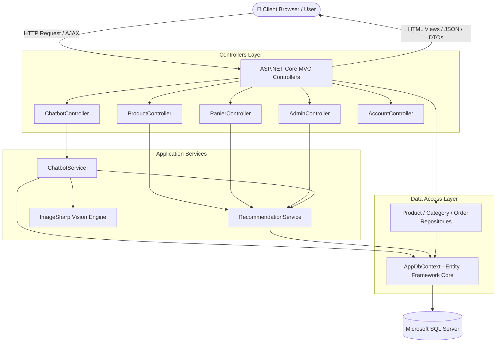
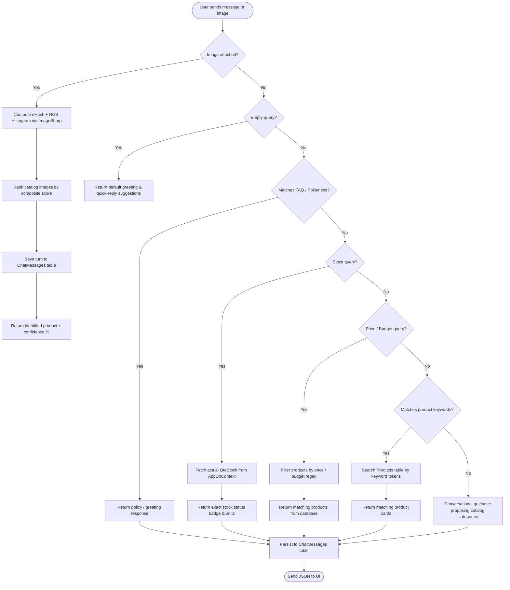

# Intelligent E-Commerce Platform — NexusStore Pro

[](https://dotnet.microsoft.com/)
[](https://docs.microsoft.com/en-us/dotnet/csharp/)
[](https://dotnet.microsoft.com/apps/aspnet)
[](https://docs.microsoft.com/ef/core/)
[](https://www.microsoft.com/sql-server)
[](https://getbootstrap.com/)

An ASP.NET Core MVC e-commerce web application with a database-grounded rule-based chatbot, visual product image search using perceptual hashing, a hybrid recommendation engine, role-based authentication, and an analytics reporting dashboard.

---

## Table of Contents

- [Project Overview](#project-overview)
- [Key Features](#key-features)
- [System Architecture](#system-architecture)
- [Chatbot Workflow](#chatbot-workflow)
- [Recommendation System](#recommendation-system)
- [Visual Product Search](#visual-product-search)
- [Technology Stack](#technology-stack)
- [Project Structure](#project-structure)
- [Database and Entity Framework Migrations](#database-and-entity-framework-migrations)
- [Installation and Configuration](#installation-and-configuration)
- [How to Run the Project](#how-to-run-the-project)
- [Testing the Main Features](#testing-the-main-features)
- [Screenshots](#screenshots)
- [Security Notes](#security-notes)
- [Future Improvements](#future-improvements)
- [Academic Context & License](#academic-context--license)

---

## Project Overview

**NexusStore Pro** is an educational and portfolio web platform developed with **ASP.NET Core MVC 9** and **Entity Framework Core 9**. It combines core e-commerce capabilities (catalog management, shopping cart, order placement, role-based security) with data-driven decision services:

1. **A Database-Grounded Hybrid Rule-Based Chatbot**: Answers customer questions about current stock levels, product prices, budget constraints, and store policies by directly querying SQL Server via Entity Framework Core.
2. **Visual Product Search**: Matches uploaded or drag-and-dropped product images against catalog images using 64-bit difference hashing (`dHash`) and color histogram comparisons through `SixLabors.ImageSharp`.
3. **A Hybrid Recommendation Engine**: Suggests related products and cart add-ons by computing a weighted score combining taxonomy (category), price proximity, and historical co-purchase patterns from prior orders.
4. **Analytics Dashboards**: Visualizes sales metrics, stock warnings, and chatbot interaction volumes.

---

## Key Features

### 🛒 E-Commerce Operations
- **Product Catalog**: Paginated product listings with search by product name, category filtering drawer, and detailed product views.
- **Shopping Cart**: Client-side interactive cart backed by session storage with dynamic quantity updates and total calculations.
- **Order Placement**: Multi-item checkout process creating persisted `Order` and `OrderItem` records.
- **Role-Based Authentication**: Built with ASP.NET Core Identity supporting `Admin` and `User` roles.

### 🤖 Chatbot & Assistant (NexusBot)
- **Natural Language Parsing**: Rule-based intent classification using regular expressions and keyword pattern matching.
- **Database Grounding**: Product availability, pricing, and stock status are fetched directly from the database, preventing invented product names or incorrect prices.
- **Conversation Persistence**: All user queries, bot replies, detected intents, matched product IDs, and timestamps are saved in the `ChatMessages` table in SQL Server.
- **1-Click Cart Addition**: Recommended products returned in the chat can be added directly to the shopping cart via AJAX.
- **Store Policy FAQs & Conversational Fallback**: Handles common questions regarding delivery, payment methods, warranty, and polite fallback responses for items not found in the catalog.

### 📊 Administrative Tools
- **Administration Dashboard**: Summary metrics for total revenue, total orders, low-stock warnings, and top-selling products using Chart.js.
- **Chatbot Analytics View**: Visual metrics for conversation volume, unique sessions, search by image frequency, intent distribution, and recent chat history.
- **Conversation Audit Log**: Paginated review of all customer-chatbot dialogs with intent badges and linked product records.

---

## System Architecture

The project follows a standard ASP.NET Core MVC architecture with repository and service layers backed by SQL Server:



---

## Chatbot Workflow

The chatbot (`ChatbotService.cs`) processes every message through a deterministic, priority-ordered pipeline:



### Why Hallucinations Are Prevented
Unlike ungrounded language model APIs, this chatbot retrieves all product attributes directly from `AppDbContext.Products`:
- **Stock values** correspond to the actual `p.QteStock` integer column.
- **Prices** reflect `p.Price` stored in SQL Server.
- If a queried product is not found in the database, the chatbot clearly states that the item is unavailable and suggests real catalog categories instead of fabricating specifications.

---

## Recommendation System

The recommendation engine (`RecommendationService.cs`) implements a transparent hybrid scoring model that combines content similarity with transaction history:

### 1. Similar Products Algorithm (`GetSimilarProductsAsync`)
When a user views a product, candidate products are evaluated using the following scoring formula:

$$\text{Score} = S_{\text{category}} + S_{\text{price}} + S_{\text{co-purchase}} + S_{\text{stock}}$$

- **Category Match ($S_{\text{category}}$)**: $+40.0$ points if the candidate belongs to the same `CategoryId`.
- **Price Proximity ($S_{\text{price}}$)**: Up to $+30.0$ points based on the relative price difference:
  $$S_{\text{price}} = \max\left(0, 1 - \frac{|P_{\text{candidate}} - P_{\text{target}}|}{\max(P_{\text{candidate}}, P_{\text{target}})}\right) \times 30.0$$
- **Co-Purchase Frequency ($S_{\text{co-purchase}}$)**: $+10.0$ points per historical co-order where both products were purchased together in the `OrderItems` table (capped at $+30.0$ points).
- **Availability Bonus ($S_{\text{stock}}$)**: $+5.0$ points if the item currently has `QteStock > 0`.

### 2. Cart Cross-Sell Recommendations (`GetCartRecommendationsAsync`)
- Analyzes items currently in the cart.
- Identifies products most frequently purchased alongside those cart items in historical `Orders`.
- If insufficient co-purchase data exists, it supplements recommendations with top in-stock products from matching categories.

### 3. Trending / Best Sellers (`GetTrendingProductsAsync`)
- Aggregates historical sales volume using `_context.OrderItems.GroupBy(i => i.ProductName).Sum(x => x.Quantity)`.

---

## Visual Product Search

The visual search engine in `ChatbotService.cs` enables users to find catalog products by uploading an image, pasting from clipboard, or dragging and dropping an image file into the chat interface.

### Algorithmic Breakdown
1. **Perceptual Difference Hashing (`ComputeDHash`)**:
   - Resizes the uploaded image to $9 \times 8$ pixels using `SixLabors.ImageSharp`.
   - Converts pixels to grayscale.
   - Compares the luminosity of adjacent horizontal pixels ($left > right$).
   - Produces a 64-bit unsigned integer fingerprint (`ulong`).
   - Compares the uploaded hash against existing catalog product image hashes using **Hamming distance**.
2. **Normalized RGB Color Histogram (`ComputeColorHistogram`)**:
   - Resizes image to $32 \times 32$ pixels.
   - Constructs a 16-bin normalized color distribution vector (5 Red bins, 5 Green bins, 6 Blue bins).
   - Computes the **Cosine Similarity** between the uploaded image vector and catalog image vectors.
3. **Composite Match Score**:
   - **Visual Score (up to 70 pts)**: Weighted combination of visual hash similarity ($65\%$) and color similarity ($35\%$).
   - **Filename Token Matching (up to 20 pts)**: Tokenizes the uploaded file name against product names and categories.
   - **User Query Context (up to 15 pts)**: Tokenizes accompanying text query against product attributes.
4. **Confidence Threshold**:
   - A product is presented as identified if the composite score exceeds the minimum threshold ($25.0$).
   - If no match exceeds this threshold, the chatbot provides closest alternative suggestions from available stock.

---

## Technology Stack

### Backend
- **Target Framework**: .NET 9.0 (`net9.0`, C# 13)
- **Web Framework**: ASP.NET Core MVC 9
- **ORM**: Entity Framework Core 9.0.10
- **Database Provider**: `Microsoft.EntityFrameworkCore.SqlServer` 9.0.10
- **Security & Identity**: `Microsoft.AspNetCore.Identity.EntityFrameworkCore` 9.0.10
- **Image Processing**: `SixLabors.ImageSharp` 4.1.3

### Frontend
- **CSS Framework**: Bootstrap 5.3 + Bootstrap Icons 1.11.3
- **Custom Styling**: Modern Glassmorphism theme (`site.css`, `chatbot.css`)
- **Scripting**: Vanilla JavaScript (ES6+), jQuery 3.x
- **Data Visualization**: Chart.js

---

## Project Structure

```text
ProductManagement/
├── Controllers/
│   ├── AccountController.cs       # Registration, login, logout, access control
│   ├── AdminController.cs         # Role management & sales dashboard
│   ├── CategoryController.cs      # Category CRUD operations
│   ├── ChatbotController.cs       # Chatbot message processing & analytics endpoints
│   ├── HomeController.cs          # Home landing page
│   ├── PanierController.cs        # Shopping cart, checkout, confirmation
│   └── ProductController.cs       # Product catalog, pagination, image upload
├── Models/
│   ├── AppDbContext.cs            # EF Core DbContext with Identity & entity mappings
│   ├── Product.cs                 # Product entity (Name, Price, QteStock, Image, CategoryId)
│   ├── Category.cs                # Category entity (CategoryName, Products)
│   ├── ChatMessage.cs             # Chat conversation log entity (SessionId, Intent, etc.)
│   ├── Order.cs & OrderItem.cs    # Customer order and line-item entities
│   ├── DbInitializer.cs           # Database migration & seed data logic
│   └── Repositories/              # Repository interfaces & EF implementations
├── Services/
│   ├── IChatbotService.cs         # Chatbot contract definition
│   ├── ChatbotService.cs          # Rule-based NLP, dHash visual search & DB persistence
│   ├── IRecommendationService.cs  # Recommendation contract
│   └── RecommendationService.cs   # Hybrid content-based & co-purchase algorithms
├── ViewModels/                    # Strongly-typed models for Razor views
├── Views/
│   ├── Chatbot/                   # Chatbot Index, Analytics, and History views
│   ├── Shared/
│   │   ├── _ChatbotWidget.cshtml  # Floating chatbot widget markup
│   │   ├── _Layout.cshtml         # Main application layout and navigation
│   │   └── _RecommendedProductsPartial.cshtml # Cross-sell product carousel
│   └── ...                        # Product, Category, Panier, and Admin views
├── Migrations/                    # EF Core migration history files
├── docs/
│   └── screenshots/               # Folder reserved for application screenshots
├── wwwroot/
│   ├── css/                       # Custom styles (site.css, chatbot.css)
│   ├── js/                        # Client scripts (chatbot.js, site.js)
│   └── images/                    # Product catalog images
├── appsettings.json               # Local development configuration
├── appsettings.example.json       # Template configuration file
└── Program.cs                     # Application bootstrap, DI registration, pipeline
```

---

## Database and Entity Framework Migrations

The database schema is managed via Entity Framework Core Code-First migrations.

### Key Entities
| Entity | Table | Description |
| :--- | :--- | :--- |
| `Product` | `Products` | Stores product details, price, inventory quantity, image file name, category foreign key. |
| `Category` | `Categories` | Categorization hierarchy for products. |
| `Order` | `Orders` | Order header storing customer name, date, total amount. |
| `OrderItem` | `OrderItems` | Line items recording product name, unit price, quantity. |
| `ChatMessage` | `ChatMessages` | Persisted chatbot sessions, user questions, bot answers, intent tags, matched product IDs. |
| `IdentityUser` / `IdentityRole` | `AspNet*` | ASP.NET Core Identity authentication and authorization tables. |

### Migration Commands
To apply existing migrations to your local SQL Server instance:
```bash
dotnet ef database update
```

To create a new migration after model changes:
```bash
dotnet ef migrations add <MigrationName>
dotnet ef database update
```

---

## Installation and Configuration

### Prerequisites
- [.NET 9.0 SDK](https://dotnet.microsoft.com/download/dotnet/9.0) (verify with `dotnet --version`)
- Microsoft SQL Server (LocalDB, SQL Server Express, or Docker container)

### 1. Clone the Repository
```bash
git clone https://github.com/ranimkoubaa/intelligent-ecommerce-platform.git
cd intelligent-ecommerce-platform
```

### 2. Configure the Connection String
Verify the connection string under `ConnectionStrings:ProductDBConnection` in `appsettings.json`:

```json
{
  "ConnectionStrings": {
    "ProductDBConnection": "Server=(localdb)\\MSSQLLocalDB;Database=ProductManagementDb;Trusted_Connection=True;MultipleActiveResultSets=true"
  }
}
```

*A template is available in [appsettings.example.json](appsettings.example.json).*

---

## How to Run the Project

### 1. Restore Dependencies
```bash
dotnet restore
```

### 2. Build the Solution
```bash
dotnet build
```

### 3. Update Database Schema
```bash
dotnet ef database update
```
*(On first execution, `DbInitializer.cs` will automatically execute migrations and seed sample categories, products with images, and orders).*

### 4. Run the Application
```bash
dotnet run
```
Open your browser and navigate to:
- `http://localhost:5000` or `https://localhost:5001`

---

## Testing the Main Features

| Test Case | Steps to Execute | Expected Result |
| :--- | :--- | :--- |
| **Catalog & Filter** | Open `/Product`, select a category from the drawer or enter a name in search. | Displays matching products with stock badges and pagination. |
| **Stock Query (Chatbot)** | Open chatbot widget and send: *"Est-ce que le Dell XPS 15 est en stock ?"* | Chatbot returns the exact units remaining from SQL Server with stock badge. |
| **Budget Search (Chatbot)** | Send: *"Produits à moins de 1000 DT"*. | Chatbot filters products $\le 1000$ DT from the database. |
| **Visual Search (Chatbot)** | Drag and drop an image (e.g. `laptop_dell.jpg` or any tech photo) into the widget. | Chatbot computes `dHash` + color histogram and returns the closest match with confidence score. |
| **1-Click Cart Addition** | In chatbot response, click the "Ajouter au panier" button on an identified product. | Product is added to cart via AJAX without page reload. |
| **Recommendations** | Navigate to `/Panier` with items in cart. | Section *"Complétez votre panier"* displays co-purchased or complementary products. |
| **Analytics Dashboard** | Navigate to `/Chatbot/Analytics`. | Displays KPI cards, intent distribution bar charts, and top demanded products. |

---

## Screenshots

Screenshots should be placed in the `docs/screenshots/` directory:

| Section | Preview |
| :--- | :--- |
| **Storefront & Catalog** | *Placeholder: `docs/screenshots/01-storefront.png`* |
| **Chatbot Widget & Stock Inquiry** | *Placeholder: `docs/screenshots/02-chatbot-widget.png`* |
| **Visual Product Search** | *Placeholder: `docs/screenshots/03-visual-search.png`* |
| **Recommendation Engine (Cart)** | *Placeholder: `docs/screenshots/04-recommendations.png`* |
| **Analytics Dashboard** | *Placeholder: `docs/screenshots/05-admin-dashboard.png`* |

> *Refer to [docs/screenshots/README.md](docs/screenshots/README.md) for guidelines on capturing and saving screenshots.*

---

## Security Notes

1. **Secrets Management**:
   - `appsettings.json` is configured for local development using Windows Integrated Authentication (`Trusted_Connection=True`) with LocalDB.
   - Never commit sensitive production credentials, API keys, or database passwords to version control.
   - For production deployment, configure settings using:
     - **ASP.NET Core User Secrets** (`dotnet user-secrets`) during development.
     - **Environment Variables** in containerized or CI/CD environments.
     - **Azure Key Vault** or a dedicated secrets manager in cloud environments.
2. **Git Ignore Rules**:
   - `.gitignore` is configured to exclude build outputs (`bin/`, `obj/`), user-specific settings (`*.user`), IDE caches (`.vs/`), and production setting files (`appsettings.Production.json`, `secrets.json`, `.env`).
3. **Data Protection**:
   - Passwords are encrypted and hashed by ASP.NET Core Identity.
   - Form posts and state-changing actions utilize CSRF tokens.

---

## Future Improvements

- **RAG / Local LLM Integration**: Incorporating a local LLM (e.g., Ollama with Llama 3 or Mistral) or an API-driven LLM using a Retrieval-Augmented Generation (RAG) pattern to support more complex conversational queries while maintaining database grounding.
- **Deep Learning Feature Extraction**: Supplementing perceptual hashing with pre-trained visual embeddings (e.g. MobileNet or ResNet ONNX runtime) for higher semantic image matching accuracy.
- **Payment Gateway**: Integrating a sandbox payment provider (e.g., Stripe or Konnect).
- **Unit & Integration Testing**: Adding automated xUnit tests for `RecommendationService` and `ChatbotService`.

---

## Academic Context & License

This project was developed in an academic context for the **Master DSIR (Distributed Systems & Intelligent Networks) - 2nd Year** curriculum for the **Advanced .NET & Web Architecture** module.

Distributed under the MIT License. See `LICENSE` for more information if applicable.
