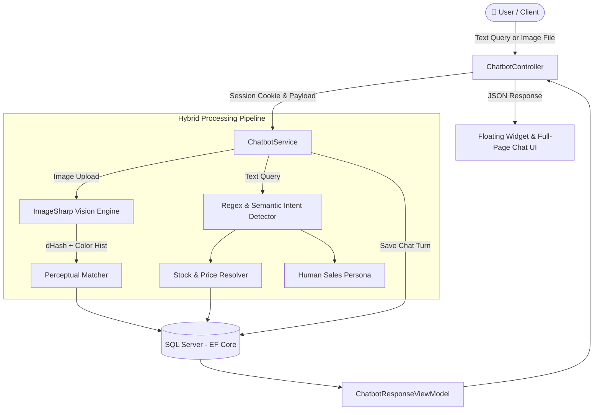

<<<<<<< HEAD
# 🛍️ Intelligent E-Commerce Platform (NexusStore Pro)
=======
# 🛍️ NexusStore Pro - ProductManagement 
>>>>>>> c18ef31d158c126ba14fe141dc6ea887e88c93cc

[](https://dotnet.microsoft.com/)
[](https://docs.microsoft.com/en-us/dotnet/csharp/)
[](https://dotnet.microsoft.com/apps/aspnet)
[](https://docs.microsoft.com/ef/core/)
[](https://www.microsoft.com/sql-server)
[](https://getbootstrap.com/)

> **A cutting-edge, intelligent e-commerce web application** built with **ASP.NET Core MVC 9**, featuring a **hybrid AI chatbot with visual product image recognition**, an **automated recommendation engine** (content-based + collaborative filtering), **real-time stock management**, and an **executive analytics dashboard**.

---

## 📌 Project Overview

NexusStore Pro goes beyond traditional e-commerce by integrating artificial intelligence and computer vision techniques natively into the ASP.NET Core stack. Customers can discover products through natural language dialogs, search for items by simply dropping or pasting photos, receive tailored personalized cross-sell recommendations, and seamlessly add items to their cart in 1 click.

---

## 🌟 Key Features

### 1. 🤖 Hybrid AI Sales Chatbot (NexusBot)
* **📸 Visual Search & Image Recognition**: Users can upload, drag-and-drop, or paste (`Ctrl+V`) an image of any product. The server analyzes visual features using:
  * **64-bit Perceptual Difference Hash (`dHash`)**: Resizes image to 9×8 grayscale and computes binary gradients resilient to scaling and aspect ratio differences.
  * **Normalized RGB Color Histograms**: Computes color distribution vectors and compares them against catalog images using Cosine Similarity.
  * **Multi-factor Scoring**: Combines visual hash proximity, color tone matching, and semantic query tokens with an accuracy confidence score.
* **📦 Real-time Database Stock Inquiries**:
  * Direct queries to SQL Server (`QteStock`, `Price`) to guarantee zero hallucinations.
  * Instant feedback on critical stock levels, low-stock warnings, and out-of-stock items.
* **💾 Full Database Conversation Persistence**:
  * Every dialog turn is persisted in the `ChatMessages` table with `SessionId`, `UserName`, detected user intent, matched product reference, and timestamp.
* **💬 Human-like Sales Assistant & Off-Catalog FAQ**:
  * Handles politeness, return policies, warranty terms, and gracefully handles queries outside the current catalog (e.g. *"do you sell sunglasses?"*).
* **🛒 1-Click Interactive Cart Additions**: Users can add recommended items directly into their shopping cart via AJAX without leaving or refreshing the chat window.



---

### 2. 🧠 Hybrid Recommendation Engine (`IRecommendationService`)
* **Content-Based Filtering**: Recommends items belonging to the same product taxonomy and falling within comparable price tiers.
* **Collaborative Filtering (Co-purchase Analysis)**: Parses historical orders and co-occurrence matrices to suggest complementary items commonly purchased together (*"Frequently bought together"*).
* **Dynamic Cart Upselling**: Automatically suggests complementary items during checkout and inside the cart drawer.

---

### 3. 📊 Executive Analytics & Admin Dashboard
* **Real-time KPI Metrics**: Total conversations, unique customer sessions, today's chat volume, and visual image searches.
* **Intent Distribution**: Visual breakdowns of user intents (`stock_query`, `price_query`, `image_search`, `faq`, `advice`, `product_search`).
* **Most Demanded Products**: Top referenced products in customer inquiries.
* **Full Paginated Audit Log**: Complete searchable history of user conversations with image thumbnails and intent tags.

---

### 4. 🛍️ E-Commerce Storefront & Order Management
* **Catalog Management**: Paginated product grid, category drawers, dynamic price filters, and keyword search.
* **Shopping Cart**: Singleton / session-backed shopping cart with instant quantity adjustments and total calculation.
* **Checkout & Orders**: Multi-item checkout flow creating `Order` and `OrderItem` database records.
* **Security & Roles**: ASP.NET Core Identity with role-based access control (`Admin`, `User`).

---

## 🏗️ Technology Stack

| Layer | Technologies |
| :--- | :--- |
| **Backend Framework** | .NET 9.0 (C# 13), ASP.NET Core MVC |
| **Data Access / ORM** | Entity Framework Core 9.0 (Code-First Migrations) |
| **Database** | Microsoft SQL Server (LocalDB / Express / Docker) |
| **Authentication & AuthZ** | ASP.NET Core Identity |
| **Computer Vision** | `SixLabors.ImageSharp` (dHash perceptual hashing, RGB histograms) |
| **Frontend UI / UX** | Bootstrap 5.3, Bootstrap Icons, Custom Glassmorphism CSS |
| **Client Scripting** | Vanilla JavaScript (ES6+), jQuery, AJAX |
| **Data Visualization** | Chart.js |

---

## 📂 Project Structure

```text
ProductManagement/
├── Controllers/              # MVC Controllers
│   ├── AccountController.cs  # Identity login & registration
│   ├── AdminController.cs    # Role management & admin dashboard
│   ├── CategoryController.cs # Product categories CRUD
│   ├── ChatbotController.cs  # AI assistant, image search & analytics endpoints
│   ├── HomeController.cs     # Landing page & featured showcases
│   ├── PanierController.cs   # Cart & checkout workflow
│   └── ProductController.cs  # Product catalog, search & pagination
├── Models/                   # Data entities & database context
│   ├── AppDbContext.cs       # EF Core DbContext definition
│   ├── Product.cs            # Product entity (Stock, Price, Image)
│   ├── Category.cs           # Category entity
│   ├── ChatMessage.cs        # Persisted chat logs & intent tracking
│   ├── Order.cs & OrderItem.cs # Order processing models
│   └── Repositories/         # Repository pattern abstractions
├── Services/                 # Business logic & algorithms
│   ├── ChatbotService.cs     # NLP, image matching & DB logging logic
│   └── RecommendationService.cs # Collaborative & content-based engine
├── ViewModels/               # DTOs & ViewModels (Chatbot, Analytics, Cart...)
├── Views/                    # Razor Views (.cshtml)
│   ├── Chatbot/              # Full-page assistant, Analytics & History views
│   ├── Shared/_ChatbotWidget.cshtml # Floating assistant partial
│   └── Shared/_Layout.cshtml # Navigation bar, theme & global layout
├── Migrations/               # Entity Framework Core migration snapshots
└── wwwroot/                  # Client-side assets
    ├── css/                  # Custom design system (site.css, chatbot.css)
    ├── js/                   # Chatbot widget logic & client scripts
    └── images/               # Product image catalog
```

---

## ⚡ Getting Started

### Prerequisites
* [.NET 9.0 SDK](https://dotnet.microsoft.com/download/dotnet/9.0)
* [SQL Server](https://www.microsoft.com/sql-server/) (LocalDB, SQL Express, or Docker container)
* Visual Studio 2022 (v17.12+) or Visual Studio Code with C# Dev Kit

### 1. Clone the repository
```bash
git clone https://github.com/ranimkoubaa/intelligent-ecommerce-platform.git
cd intelligent-ecommerce-platform
```

### 2. Configure Database Connection
Review your connection string in `appsettings.json`:
```json
{
  "ConnectionStrings": {
    "DefaultConnection": "Server=(localdb)\\mssqllocaldb;Database=ProductManagementDb;Trusted_Connection=True;MultipleActiveResultSets=true"
  }
}
```

### 3. Run EF Core Migrations
Create and update the SQL Server database schema automatically:
```bash
dotnet ef database update
```

### 4. Build and Run
```bash
dotnet run
```
Navigate to `https://localhost:5001` or `http://localhost:5000` in your web browser.

---

## 🧪 Testing the AI Assistant

1. **Text Stock Inquiry**: Ask *"Quel est l'état global du stock ?"* or *"Est-ce que le Dell XPS est disponible ?"*.
2. **Budget Query**: Type *"Montre-moi les produits à moins de 500 DT"*.
3. **Visual Product Search**: Click the camera icon or drag & drop any image into the chatbot widget (e.g., photo of a laptop or headphones) to trigger real-time perceptual matching.
4. **Analytics View**: Browse to `/Chatbot/Analytics` to inspect conversation volume, intent bar charts, and top demanded products.

---

## 📄 License & Credits

Developed as part of the **Master DSIR (Distributed Systems & Intelligent Networks) - 2nd Year** curriculum for the Advanced .NET & Web Architecture module.
